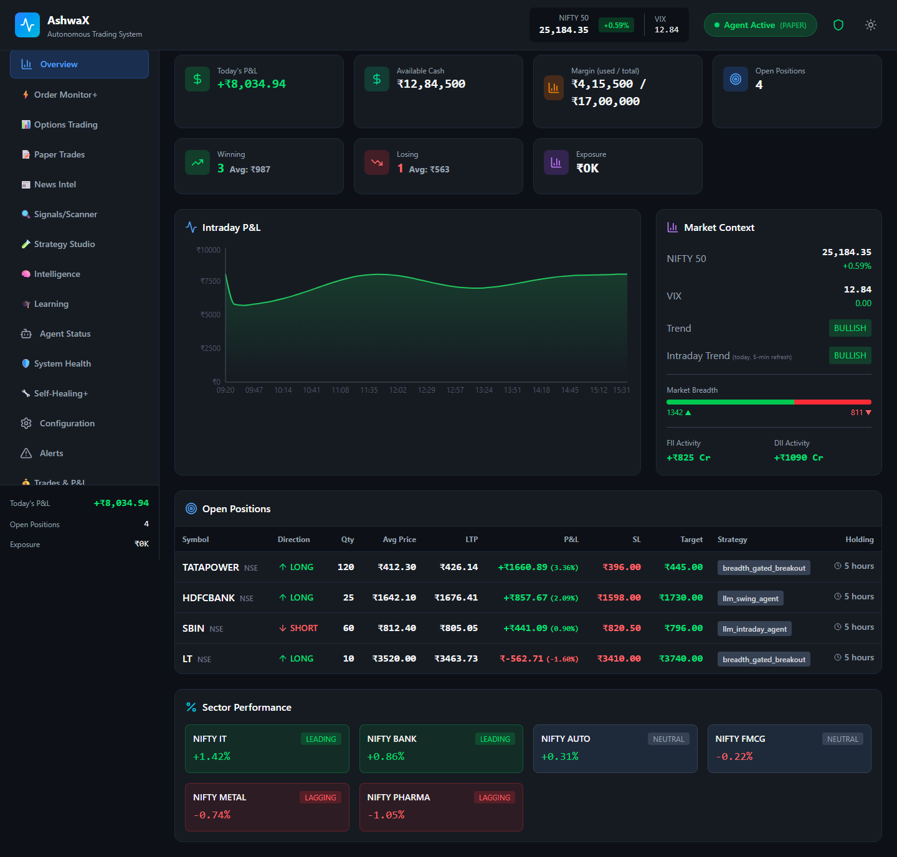
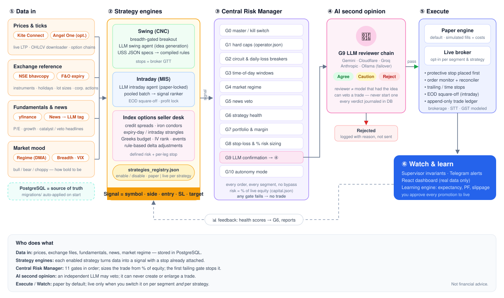

# AshwaX

**A fully automatic trading system for Indian markets** (NSE equities and NIFTY / BANKNIFTY
index options). Once you switch it on and set your limits, it finds trades, sizes them, checks
them, places them, protects them, manages them and closes them — **with no human clicking
anything**. Every order, from every strategy, paper or live, must first pass an 11-gate Central
Risk Manager and an independent LLM second opinion before it can reach a broker.

> **Paper trading is the default and this repository ships paper-locked.** Nothing here is
> financial advice. If you switch anything to live, you alone are responsible for the orders
> it places. **Live orders also require a registered static IP address** (see
> [Prerequisites](#prerequisites)).



<sub>All screenshots in this README use made-up sample data, not a real account.</sub>

**Contents:** [Prerequisites](#prerequisites) · [What "fully automatic" means](#what-fully-automatic-means-here) · [What makes it different](#what-makes-it-different) · [How it works](#how-it-works) · [Supported brokers](#supported-brokers) ·
[Phase 1](#phase-1--what-is-in-this-release) · [Roadmap](#roadmap) ·
[Dashboard tour](#dashboard-tour) · [Quick start](#quick-start) ·
[Controlling the system](#controlling-the-system) · [Configuration](#configuration-at-a-glance) · [Safety design](#safety-design) ·
[Project layout](#whats-inside)

---

## What "fully automatic" means here

With `autonomy_mode: autonomous` (the shipped setting) a trade's whole life needs no human step:

1. **Find** — strategies scan prices, breadth, sector strength, options chains and news all
   session long, and an LLM agent proposes swing and intraday ideas.
2. **Size** — position size is calculated from your live account equity and the distance to the
   stop, so the rupees at risk are fixed in advance.
3. **Check** — the Central Risk Manager runs 11 gates (kill switch, caps, loss breakers, time
   windows, regime, news, strategy health, margin, stop-loss, LLM review, autonomy). One failed
   gate and the trade never happens.
4. **Second opinion** — a different LLM from the one that had the idea reviews it and can veto it.
5. **Execute** — the entry is sent (simulated in paper mode, to the broker in live mode) and the
   protective stop is placed first.
6. **Manage** — an order monitor and reconciler watch every position against the broker; trailing
   stops, targets, time stops and per-leg option stops fire on their own.
7. **Close** — intraday positions are squared off before the close, a daily-loss breaker closes
   all intraday positions if the day goes wrong, and an equity floor halts trading entirely.
8. **Report and learn** — every decision is logged, Telegram alerts report what happened, and the
   learning engine shrinks the size of any strategy that starts losing.

What you still do: set the limits once, keep the broker session valid (Kite needs a fresh token
each trading day; on Windows this can be automated, in Docker you paste it), and read the
reports. You can pause everything at any time with the master switch, or set
`autonomy_mode: manual` to stop new entries. See [Controlling the system](#controlling-the-system).

## What makes it different

These are specific, checkable properties of this codebase, not marketing claims:

- **The risk manager cannot be bypassed.** There is one path to a broker, and every strategy goes
  through the same 11 gates. The limits are %-of-equity numbers in config files, so they scale
  with your account.
- **Nothing grades its own homework.** The LLM that originates an idea is deliberately excluded
  from reviewing it, and a missing verdict means no trade (fail closed), not a guess.
- **Protection comes first.** The stop is placed before the position is considered "open", option
  structures are defined-risk or carry per-leg stops, and swing stops are also backed by broker
  GTT orders.
- **It fails safe.** Missing data, a crashed component or a broken reconciliation blocks new
  trades instead of continuing blindly; a daily-loss breaker for intraday and an absolute equity floor for the whole account are
  built in.
- **Paper first, with a written bar to go live.** One code path serves paper and live, strategies
  start on paper, and each needs enough trades with positive after-cost expectancy before it is
  promoted. Backtests run at 0.10 % costs and only ever add confidence; they never replace
  forward results.
- **Honest about edge.** Strategies that failed testing are disabled or removed rather than
  tuned until they pass, and `scripts/research/` keeps the tests, including the failures.
- **Every decision is explainable.** Signals, gate verdicts, LLM reasoning, orders and fills are
  all stored in PostgreSQL and in an append-only trade ledger, and the dashboard shows only real
  data, never placeholders.
- **It learns, but only changes what you allow.** The learning engine tracks expectancy,
  calibration and failure causes and scales position size by strategy health. Automatic
  parameter promotion exists but is **switched off by default** (`config/learning.json`), and
  nothing ever moves a strategy from paper to live on its own — that is always a manual edit.

None of this guarantees profit. Markets can and do beat well-built systems; the design goal is
to keep losses small, known in advance and survivable.

---

## How it works



1. **Data in** — live prices and option chains from the broker, NSE reference files (bhavcopy,
   instruments, holidays, expiries), fundamentals (yfinance), a news feed tagged by a background
   LLM, and a market-regime / breadth model. Everything is stored in PostgreSQL, which is the
   single source of truth for state.
2. **Strategy engines** — each strategy enabled in `config/strategies_registry.json` produces a
   signal that already includes its entry, stop and target:
   - **Swing (CNC)** — rule-based specs (USS JSON, compiled) plus an LLM idea-generation agent.
   - **Intraday (MIS)** — ideas are pooled and ranked as a batch; nothing is taken just because it
     arrived first.
   - **Index-options seller desk** — defined-risk credit spreads and condors, expiry-day and
     intraday strangles with per-leg stops, a Greeks budget, IV-rank and event blackouts, and
     frozen rule-based adjustments.
3. **Central Risk Manager (CRM)** — gates G0–G10 run in order: kill switch, hard caps, circuit and
   daily-loss breakers, time windows, regime, news veto, strategy health, portfolio and margin,
   stop-loss and %-of-equity sizing, LLM confirmation, autonomy mode. The first gate that fails
   stops the trade. No strategy can bypass the CRM.
4. **AI second opinion (G9)** — a reviewer chain with automatic failover (Gemini, Cloudflare
   Workers AI, Groq, Anthropic, Ollama). The reviewer is never the model that came up with the
   idea. It can veto a trade but never start or enlarge one, and every verdict is written to the
   database.
5. **Execute** — fills go to the paper engine (with simulated costs) unless that segment **and**
   that strategy are both switched to live. Protective stops are placed first. An order monitor
   and a reconciler keep the database in line with the broker, and every fill is recorded in an
   append-only trade ledger.
6. **Watch & learn** — supervisor invariants, Telegram alerts and a React dashboard that shows
   only real data. A learning engine tracks expectancy, profit factor and slippage and feeds
   strategy-health scores back into gate G6. It never promotes a strategy to live on its own.

---

## Supported brokers

| Broker | Status | Notes |
|---|---|---|
| **Paper (built-in)** | ✅ Default, fully supported | Simulated fills, stops, GTT-style OCO and costs, so no order ever reaches a broker. Live **market data still comes from a Kite Connect API key** (see below). |
| **Zerodha Kite Connect** | ✅ Primary broker — required, even for paper (paid data plan; static IP for live orders) | Supplies market data in paper mode and orders in live mode. Quotes, option chains, historical data, margins, orders, native GTT for swing stops, automated daily TOTP login. |
| **Flattrade, Angel One, Upstox** | 🔲 Planned | Not supported yet. Flattrade and Angel One are next (Phase 2), Upstox after that. See the [roadmap](#roadmap). |

Select the broker with `BROKER=paper | kite` in `.env` (unset = paper). Order execution goes
through one `BrokerInterface` (`src/brokers/base.py`); some market-data and dashboard code still
calls Kite directly today, which is what stops other brokers from being added yet (see the
[roadmap](#roadmap)). Per-broker differences — product codes, GTT support,
bracket orders, websocket limits — are declared in `src/brokers/capability_matrix.json`.

Exchanges and instruments: NSE cash equities (CNC delivery and MIS intraday) and NSE index
options on NIFTY / BANKNIFTY. Futures, commodities and currency are out of scope.

---

## Phase 1 — what is in this release

Phase 1 is a **paper-first trading lab with a hardened risk core**. The goal is to collect
honest, after-cost forward results for each strategy before any real money is involved.

**Included**

- Central Risk Manager (G0–G10), %-of-equity sizing, drawdown size steps, daily-loss breaker with
  force-flatten, absolute equity floor, and a master paper lock.
- Paper and live execution paths that share one code path, with protective stops placed first.
- Order monitor, reconciler against the broker, GTT backup orders, append-only trade ledger.
- Independent LLM review (G9) with a multi-provider failover chain and per-purpose daily call caps.
- News ingestion and classification, market regime, breadth, and sector rotation models.
- Learning engine: expectancy, calibration of LLM confidence, failure attribution, strategy
  health tiers that shrink position size automatically.
- React dashboard with 17 tabs, Telegram alerts, PostgreSQL storage with auto-applied migrations.
- One-command Docker setup (`docker compose up -d --build`): app, PostgreSQL and Redis.
- Backtest and research scripts in `scripts/` and `scripts/research/`, run at 0.10 % cost.

**Strategies shipped (all `execution_mode: "paper"`)**

| Strategy | Segment | State |
|---|---|---|
| `breadth_gated_breakout` | Swing | Enabled, paper. Takes no trades while market breadth is weak. |
| `llm_swing_agent` | Swing | Enabled, paper. LLM proposes ideas; CRM and G9 gate them. |
| `llm_intraday_agent` | Intraday | Enabled, paper-locked. |
| `options_seller_desk_v3` | Options | Enabled, paper. Defined-risk credit spreads on NIFTY / BANKNIFTY. |
| `nifty_weekly_condor_simple` | Options | Enabled, paper. Weekly iron condor. |
| `options_expiry_day` | Options | Enabled, paper. NIFTY expiry-day short strangle with per-leg stops. |
| `options_intraday_short_premium` | Options | Enabled, paper. Daily NIFTY strangle with per-leg stop. |
| `minervini_vcp`, `oneil_canslim`, `news_catalyst_momentum` | Swing / intraday | **Disabled.** Kept as reference; `minervini_vcp` failed its hold-out test. |

A strategy being enabled does **not** mean it has a proven edge. Treat every result as
unproven until it clears the promotion bar in [Going live](INSTALL.md#14-before-you-ever-go-live).

**Known limits of Phase 1**

- Windows is the tested platform. Stored broker credentials use the Windows machine-wide
  DPAPI store; on Linux / macOS / Docker they come from environment variables and only paper
  trading is tested.
- Docker (`docker compose up -d --build`) is a single paper-only image with the dashboard's
  dev server; see [INSTALL.md](INSTALL.md#docker).
- Only Zerodha Kite Connect is supported, and it is the only broker this has been run against.
- Option stop-losses are enforced by the system, not by resting broker-side orders.

---

## Roadmap

Plans, not promises — none of this is in the current release. The order follows one rule:
anything that protects capital comes before anything that adds trades.

### Phase 1 — paper-first lab *(this release)*
Risk core, paper and live execution paths, seven options and equity strategies running in paper,
LLM review, learning engine, 17-tab dashboard, Docker one-command setup.

### Phase 2 — safe to run live
- **Broker-side protection for options.** Resting stop orders for option legs so a stop survives
  a crash or restart of this process.
- **Real assisted mode.** An approve-each-trade queue in the dashboard (accept, reject or let it
  time out) so `assisted` actually waits for you, replacing today's unused `ask_mode` settings.
- **Promotion tooling.** One report per strategy that checks the written bar (trade count,
  profit factor, expectancy, slippage versus model) and refuses a switch to live until it is met.
- **Make the app broker-independent.** Route the dashboard API, the data downloader, login and
  paper-mode prices through the broker interface instead of calling Kite directly. This is the
  prerequisite for supporting any other broker.
- **More brokers: Flattrade and Angel One.** The next brokers to add after Zerodha, each validated
  in paper-versus-broker runs, including how its stops and orders behave, before it is listed as
  supported.
- **Production-grade containers.** Separate API, orchestrator and dashboard containers, a built
  (not dev-server) dashboard, and a tested live-broker login path.
- **Automatic Kite session refresh in Docker** without pasting a daily token.

### Phase 3 — more strategies and wider reach
**New strategies.** Added only after they pass an out-of-sample test **after costs**; ideas that
fail are recorded and dropped, not tuned until they pass. Candidates under research in
`scripts/research/`:
- Pullback-in-trend and breakout variants for swing, with breadth and sector filters.
- Intraday edges beyond the LLM agent (opening-range, last-hour behaviour), kept paper-only
  until after-cost expectancy is proven.
- More options structures (calendar and diagonal spreads, iron butterfly variants) with
  defined risk and rule-based adjustments.
- Volatility-regime strategies using IV rank, IV-versus-realised spread and term structure.
- A strategy-selection layer that sizes each strategy by its recent health instead of
  switching strategies on and off by hand.

**Usability and reach.**
- Guided setup in the dashboard (broker login, API keys, Telegram) instead of editing `.env`.
- A strategy builder UI on top of the USS JSON spec.
- **More brokers:** Upstox, validated the same way before it is listed as supported.
- Hosted / multi-account mode with per-account risk limits.

### Phase 4 — better research and execution
- Walk-forward and Monte-Carlo validation built into the backtester, with an out-of-sample
  report saved next to every strategy.
- Slippage and fill model calibrated from real fills, and smarter order slicing for larger size.
- Portfolio-level risk: correlation and sector exposure limits across strategies.
- Event-aware trading: earnings, RBI and index-rebalance calendars wired into entries and exits.
- Replay mode: re-run any past day through the full pipeline to reproduce a decision.

Have an idea? Open an issue — and see [CONTRIBUTING.md](CONTRIBUTING.md) for what a strategy
proposal needs.

---

## Dashboard tour

Sample data throughout. Open `http://localhost:5173` after starting the system.

| Tab | What it shows |
|---|---|
| **Overview** — [screenshot](assets/screenshots/overview.png) | Today's P&L, funds and margin, intraday P&L curve, market regime, breadth, FII / DII, open positions, sector strength. |
| **Order Monitor+** — [screenshot](assets/screenshots/order-monitor.png) | Open and closed positions, swing book, GTT backup orders, monitor health and auto-actions. |
| **Options Trading** — [screenshot](assets/screenshots/options.png) | Each options structure with legs, live P&L, max profit / loss, breakevens, Greeks budget. |
| **Paper Trades** — [screenshot](assets/screenshots/paper-trades.png) | Every simulated trade across segments with LLM verdict and regime. |
| **News Intel** — [screenshot](assets/screenshots/news.png) | Classified headlines with sentiment, impact and the trading action taken. |
| **Signals / Scanner** — [screenshot](assets/screenshots/scanner.png) | Nightly VCP setups and relative-strength leaders. |
| **Strategy Studio** — [screenshot](assets/screenshots/strategy-studio.png) | Strategy toggles, paper / live mode per strategy, backtest results and pass / fail. |
| **Intelligence** — [screenshot](assets/screenshots/intelligence.png) | LLM and agent intelligence status. |
| **Learning** — [screenshot](assets/screenshots/learning.png) | Strategy health tiers, win / loss attribution, LLM calibration, detected patterns. |
| **Agent Status** — [screenshot](assets/screenshots/agent-status.png) | Processes, database, broker and LLM connection health. |
| **System Health** — [screenshot](assets/screenshots/system-health.png) | LLM provider chains, gap risk, edge decay, cost erosion. |
| **Self-Healing+** — [screenshot](assets/screenshots/self-healing.png) | Reconciliation runs and automatic repairs. |
| **Configuration** — [screenshot](assets/screenshots/configuration.png) | Live editor for every `config/*.json` file. |
| **Alerts** — [screenshot](assets/screenshots/alerts.png) | Breaches and system alerts. |
| **Trades & P&L** — [screenshot](assets/screenshots/trades-pnl.png) | After-cost P&L by segment, weekly bars, cost-erosion gate. |
| **Reports** — [screenshot](assets/screenshots/reports.png) | Tax and performance reports. |
| **Logs** | Every component's log file, with paging and download. |

---

## Prerequisites

| You need | For | Notes |
|---|---|---|
| **Zerodha account + Kite Connect developer app with the paid market-data plan** | Everything, **including paper trading** | Paper mode simulates orders but takes live prices, option chains and history from Kite. Setup and plans: [INSTALL.md section 6](INSTALL.md#6-broker-connection-kite-connect--needed-even-for-paper-trading) |
| **A registered static public IP address** | **Live trading only** | **LIVE TRADING WILL NOT WORK WITHOUT IT.** Zerodha rejects every API order that does not come from a static public IP registered in your Kite developer console. Paper trading is not affected, because it sends no orders to the broker |
| Python 3.13+, PostgreSQL 14+, Node 20.19+ / 22+ | Running natively | Or use Docker instead (next row) |
| Docker with Compose v2 | Running with one command | Replaces the Python, PostgreSQL, Redis and Node installs |
| At least one LLM API key | AI second opinion, news tagging | Free tiers work (Gemini, Groq, Cloudflare) |
| Telegram bot | Mobile alerts (optional) | |

Windows 11 is the tested platform. Full details are in [INSTALL.md](INSTALL.md).

## Quick start

```bash
git clone https://github.com/samhitrix/Ashwax.git AshwaX && cd AshwaX
python -m venv .venv && source .venv/bin/activate     # Windows: .venv\Scripts\activate
pip install -e ".[dev]"
cp .env.example .env                                  # set DB_URL at minimum
createdb ashwax                                       # empty PostgreSQL database
cd dashboard_react && npm install && cd ..
python launcher.py                                    # then open http://localhost:5173
```

The full step-by-step guide, including broker login, LLM keys, Telegram, running as a Windows
service and troubleshooting, is in **[INSTALL.md](INSTALL.md)**.

---

## Controlling the system

Every control below is a plain setting in `config/*.json`. Change it in the dashboard
(**Configuration** tab) or edit the file, then restart (`docker compose restart app`, or restart
the launcher). The three safety switches act at different levels and **the strictest one wins**:

| Level | Setting | If it says "stop" |
|---|---|---|
| Whole account | `operator.json` → `account.paper_mode_locked` | Everything is forced to paper, whatever the other files say |
| Whole system / one segment | `global.json` → `system.master_switch` and `system.segments.<segment>.master_switch` | Gate G0 blocks every new trade (kill switch). The system-wide switch overrides a segment's |
| One strategy | `strategies_registry.json` → `enabled`, `execution_mode` | That strategy produces nothing, or runs on paper only |

`<segment>` is `intraday` (MIS), `swing` (CNC) or `options`.

### Autonomy mode: manual, assisted, autonomous

Set per segment in `global.json` → `system.segments.<segment>.autonomy_mode` (the system-wide
`system.autonomy_mode` is the fallback). Gate G10 enforces it on every order.

| Mode | What happens to a trade that passes all risk gates |
|---|---|
| `manual` | **Blocked.** Nothing is entered automatically. Use it to freeze new entries while open positions keep their stops and exits |
| `assisted` | Currently behaves like `autonomous` (see the note below) |
| `autonomous` | Entered automatically with no human in the loop |

> **Honest note on `assisted`.** The mode and its `ask_mode` settings exist in the config, but
> this release has **no approve-each-trade queue yet**: G10 lets an `assisted` trade through, and
> the `ask_mode` block in `global.json` is not read by any code. The only "ask" behaviour today
> is automatic: when a strategy's health turns *stressed*, new entries are skipped until it
> recovers. If you want a human to approve every trade, use `manual` and place the trades
> yourself. A real approval flow is on the [roadmap](#roadmap).

### Paper, live and observe-only

| Setting | Values | Effect |
|---|---|---|
| `segments.<segment>.paper_mode` | `true` / `false` | `true`: orders are simulated, nothing reaches the broker. `false`: real orders, real money. Segments can differ and run side by side |
| `segments.<segment>.shadow_mode` | `true` / `false` | `true`: signals are evaluated and logged but **no order is placed**, not even a paper one. Good for watching a strategy without trading it |
| `strategies_registry.json` → `execution_mode` | `paper` / `live` | Per-strategy lock. A strategy set to `paper` stays on paper even if its segment is live |
| `strategies_registry.json` → `llm_gate_required` | `true` / `false` | `true`: the trade needs an LLM second-opinion verdict, and no verdict means no trade |
| `strategies_registry.json` → `enabled` | `true` / `false` | Turns a strategy on or off |

Going live needs all three layers to allow it: the account unlocked, the segment's
`paper_mode` set to `false`, and the strategy's `execution_mode` set to `live`.

### The main risk limits

All in `config/capital.json`, as a **percentage of live account equity**, so every limit and every
position size scales with your account. The values below are the shipped defaults.

| Setting | Default | What it does |
|---|---|---|
| `account.max_loss_if_everything_open_hits_stop` | 3% | Shared risk pool: the combined stop-loss distance of all open positions across all segments can't exceed this |
| `account.stop_all_trading_if_equity_falls_below` | 25% | Absolute floor: below this the system stops trading |
| `account.drawdown_steps` | 3% → 75%, 5% → 50%, 8% → 25%, 10% → 0% | As the account falls from its start, position size shrinks to the stated share, down to zero |
| `swing.max_loss_per_trade` | 0.2% | Swing position size = this amount ÷ distance to the stop |
| `swing.max_open_trades` / `max_new_trades_per_day` | 12 / 2 | Caps on open swing positions and new entries per day |
| `swing.keep_unused_cash_buffer` | 10% | Cash a swing entry may never use |
| `intraday.max_loss_per_trade` | 0.05% | Same sizing rule for intraday |
| `intraday.max_loss_per_day` | 0.15% | When reached, every open intraday position is closed and no new entries are taken until tomorrow (`close_all_positions_when_daily_loss_hit`) |
| `options.max_structure_loss_per_strategy` | 0.75% | Worst-case loss of one options structure; the number of lots is chosen to fit |
| `options.max_loss_per_day_per_strategy` / `..._all_options_strategies` | 0.25% / 0.5% | Daily loss limits for one options strategy and for all of them together |
| `options.max_open_strategies` | 3 | Maximum simultaneous options structures |

Every key has a `_note` or `_rule` next to it in the file explaining it in detail, and the
Configuration tab shows them as you edit.

---

## Configuration at a glance

| File | Controls |
|---|---|
| `config/global.json` | segments (`paper_mode` per intraday / swing / options), LLM chains, feature flags |
| `config/capital.json` | every money limit, as **% of live equity** (shared risk pool, drawdown steps) |
| `config/operator.json` | hard limits and `account.paper_mode_locked` (master paper lock) |
| `config/strategies_registry.json` | which strategies are enabled; `execution_mode` paper/live per strategy |
| `config/options_settings.json` | options desk: structures, stops, Greeks budgets, adjustments |
| `config/market_hours.json` | market / AMO windows |
| `config/charges.json` | brokerage, STT, GST and stamp duty for after-cost P&L |

Every file has `_note` fields that explain each key. `config/examples/` keeps a paper-only
baseline that a unit test checks.

---

## Safety design

- **Paper first.** This repo ships with `paper_mode_locked: true`, every segment set to
  `paper_mode: true` and every strategy set to `execution_mode: "paper"`. Going live means
  changing all three on purpose.
- **Risk before profit.** Position size comes from % of live equity and the distance to the
  stop. A daily-loss breaker force-flattens positions and an absolute equity floor halts trading.
- **Fail closed.** If a required LLM verdict, breadth data or another gate input is missing, the
  trade is skipped. It is never guessed through.
- **Backtests only add confidence.** A weak backtest lowers confidence but cannot hard-block a
  trade by itself, and a good backtest is not enough to promote a strategy to live.
- **Everything is logged.** Signals, gate decisions, LLM verdicts, orders and fills are all
  stored and can be replayed.

---

## What's inside

| Area | Where |
|---|---|
| Orchestrator (all loops) | `src/orchestrator.py` |
| Central Risk Manager (G0–G10) | `src/risk/crm.py`, `src/risk/` |
| Orders, paper engine, brokers | `src/execution/`, `src/paper_trading/`, `src/brokers/` |
| Strategies (USS specs, LLM agents) | `strategies/builtin/`, `src/strategies/` |
| Index-options seller desk | `src/options/` |
| LLM providers / failover | `src/llm/` |
| Market data, regime, breadth | `src/market_data/`, `src/market/` |
| News pipeline | `src/news/` |
| Supervisor / learning | `src/supervisor/`, `src/learning/` |
| Dashboard API / UI | `src/api/`, `dashboard_react/` |
| Config (single source of truth) | `config/*.json` |
| DB schema (auto-applied) | `migrations/*.sql` |
| Backtests / research scripts | `scripts/`, `scripts/research/` |

## Tests

```bash
pytest -q
```

## Contributing

Contributions are welcome — see [CONTRIBUTING.md](CONTRIBUTING.md) for the ground rules
(risk controls, paper-first, evidence for strategies) and how to get set up.

## License

[PolyForm Noncommercial 1.0.0](LICENSE). You may read, run, modify and share this software for
**noncommercial** purposes. You may **not** sell it, or use it to provide a paid product or
service. This is a source-available license, not an open-source (OSI) license. For any
commercial use, contact the author for a separate license.
